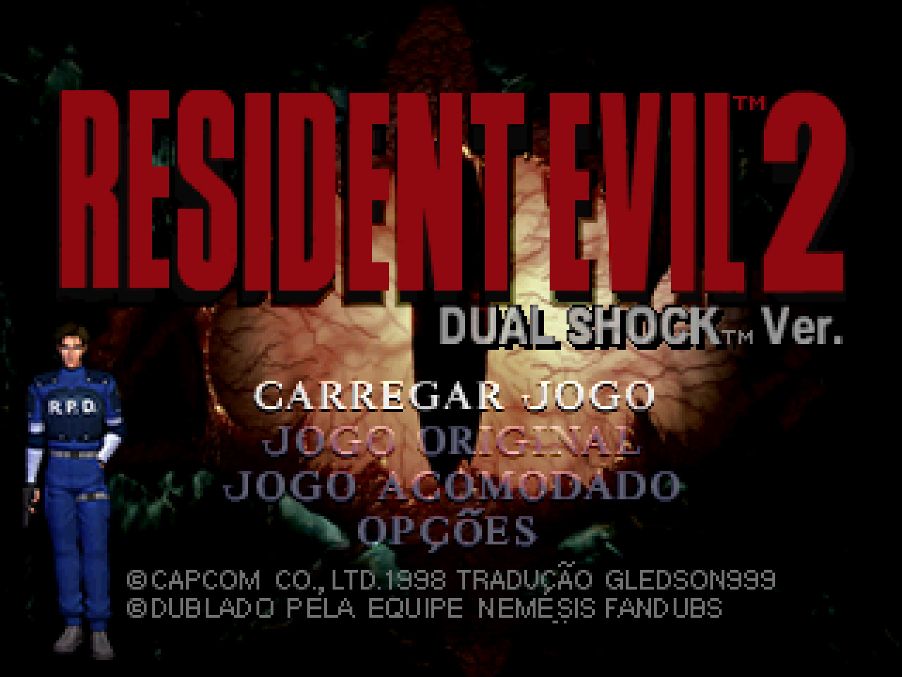
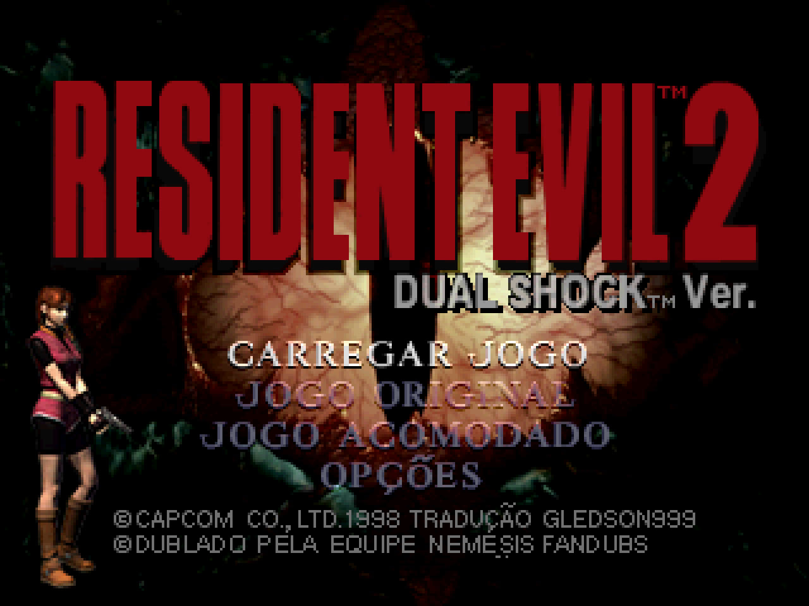
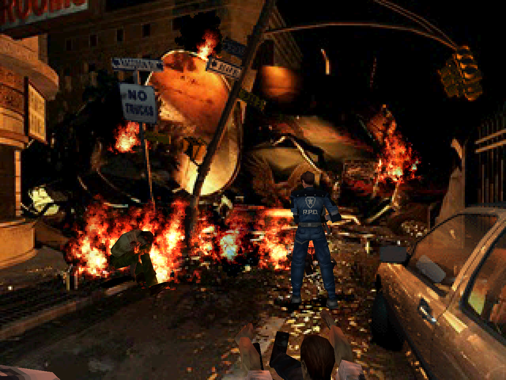
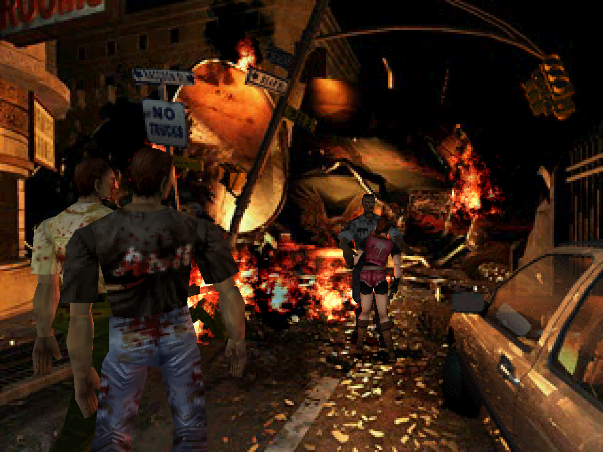
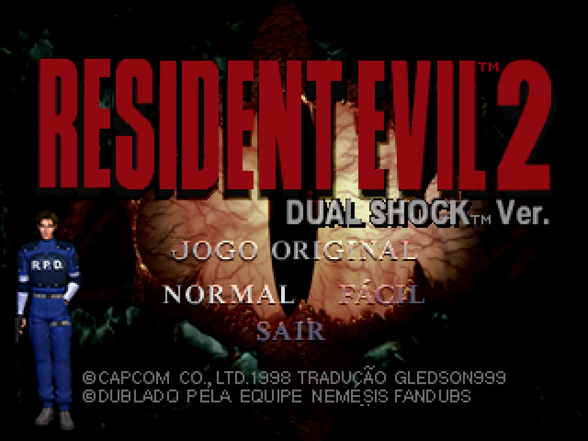
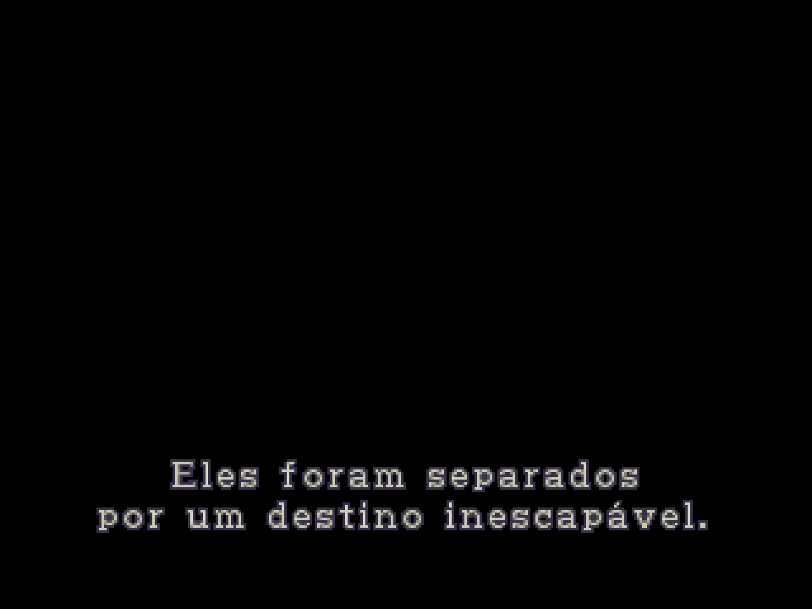

# Resident Evil 2 Recompiled

Port nativo para Windows do **Resident Evil 2: Dual Shock Ver. (PlayStation, USA)**, com
**os dois discos numa instalação só**: CD1 (Leon, SLUS-00748) e CD2 (Claire, SLUS-00756). Feito
por **recompilação estática** com o [psxrecomp](https://github.com/mstan/psxrecomp): o executável
de cada disco é traduzido para C e compilado como um programa nativo do PC, sem emular a CPU.

Funciona com a versão original em inglês ou com a **dublagem brasileira da Equipe Nemesis
Fandubs** (as fotos abaixo são da versão dublada).

| Leon (CD1) | Claire (CD2) |
|---|---|
|  |  |
|  |  |
| **Escolha de dificuldade** | **Abertura legendada** |
|  |  |

## Recursos

- Dois executáveis nativos para Windows (64 bits), **um por disco**, na mesma pasta:
  `ResidentEvil2_Leon.exe` e `ResidentEvil2_Claire.exe`
- Os dois compartilham os memory cards virtuais: o save do cenário A de um personagem é lido
  pelo outro para jogar o cenário B (o "zapping" do jogo original)
- Parte do código que o jogo carrega do disco (título, menus, memory card) é pré-compilada na
  instalação; o resto é compilado em segundo plano na primeira vez e fica guardado
- Launcher com verificação do disco, configuração de controles e memory cards
- Controles Xbox, DualShock e DualSense, ou teclado
- Opções de vídeo do psxrecomp (resolução interna maior, widescreen)

---

## Como instalar (passo a passo)

São **5 passos**. Você só faz isso uma vez.

### Passo 1: tenha as imagens dos SEUS dois discos

Este repositório **não contém o jogo**. Você precisa das imagens dos seus próprios discos do
**Resident Evil 2: Dual Shock Ver. (USA)** no formato **BIN/CUE**: para cada disco, um `.bin` e
um `.cue` juntos na mesma pasta.

| Disco | Personagem | Serial |
|---|---|---|
| CD1 | Leon | SLUS-00748 |
| CD2 | Claire | SLUS-00756 |

- Para criar as imagens a partir dos seus CDs, siga o
  [guia de dump do Redump](http://wiki.redump.org/index.php?title=Dumping_Guides).
- É a versão **Dual Shock** (capa preta com o selo "Dual Shock"). A primeira edição de 1998
  (SLUS-00421 / SLUS-00592) não serve.
- Se suas imagens estiverem em **CHD**, converta para BIN/CUE com o `chdman` (vem com o MAME):

  ```bash
  chdman extractcd -i "Resident Evil 2 (Disc 1).chd" -o "Resident Evil 2 (Disc 1).cue" -ob "Resident Evil 2 (Disc 1).bin"
  ```

> Guarde as imagens numa pasta fixa, por exemplo `C:\Jogos\Resident Evil 2\`.
> O jogo lê os discos dessa pasta toda vez que abre, então não mova nem apague as imagens depois.

#### Quer o jogo dublado em português? (opcional)

A dublagem da Equipe Nemesis Fandubs vem como **patches `.ppf`**, um para cada disco, e é aplicada
sobre as imagens originais. Pegue os patches nos canais oficiais da equipe e aplique com a
ferramenta que vem neste projeto (depois do Passo 3, já com o Python instalado):

```powershell
python scripts\aplicar_ppf.py "C:\Jogos\Resident Evil 2\Disc 1.bin" "C:\Jogos\patches\LEON_CD1.PPF" "C:\Jogos\Resident Evil 2\Leon dublado.bin"
```

```powershell
python scripts\aplicar_ppf.py "C:\Jogos\Resident Evil 2\Disc 2.bin" "C:\Jogos\patches\CLAIRE_CD2.PPF" "C:\Jogos\Resident Evil 2\Claire dublado.bin"
```

A ferramenta confere se a imagem é a versão certa, **não altera o original** e cria o `.cue` do
disco dublado ao lado do novo `.bin`. No Passo 4, escolha esses `.cue` dublados.

### Passo 2: instale o Git e o Python

1. Clique com o botão direito no **menu Iniciar** e escolha **Terminal** (ou **Windows PowerShell**).
2. Cole este comando e aperte **Enter**:

   ```powershell
   winget install Git.Git Python.Python.3.12
   ```

3. Aceite o que for pedido e espere terminar.
4. **Feche a janela do PowerShell e abra uma nova.** Sem isso, os comandos novos não são reconhecidos.

> Já tem Git e Python instalados? Pode pular este passo.

### Passo 3: baixe este projeto

No PowerShell novo, cole os dois comandos abaixo, um de cada vez, apertando **Enter** depois de cada um:

```powershell
cd $HOME\Downloads
```

```powershell
git clone https://github.com/lleandroRodrigzz/ResidentEvil2Recomp.git
```

Isso cria a pasta `Downloads\ResidentEvil2Recomp`.

### Passo 4: rode o instalador

Ainda no PowerShell, cole:

```powershell
cd ResidentEvil2Recomp
```

```powershell
powershell -ExecutionPolicy Bypass -File setup.ps1
```

1. Vão abrir **duas janelas**, uma depois da outra:
   - a primeira pede o **`.cue` do CD1 (Leon)**;
   - a segunda pede o **`.cue` do CD2 (Claire)**.
2. O instalador faz tudo sozinho:
   - baixa o psxrecomp, o launcher e um compilador (cerca de 209 MB);
   - gera o código do jogo a partir dos seus dois discos;
   - compila o Leon e a Claire e coloca os dois na mesma pasta;
   - **pré-compila o código que o jogo carrega do disco** e que ele consegue identificar;
   - cria os atalhos **Resident Evil 2 - Leon** e **Resident Evil 2 - Claire** na Área de Trabalho.
3. **Espere de 40 a 90 minutos** e não feche a janela. Vão aparecer muitas mensagens, e isso é normal.
4. Quando aparecer **"Pronto!"** em verde, terminou.

> **Espaço necessário:** cerca de **3 GB** livres (o projeto, o compilador, o código dos dois
> discos e a pré-compilação).
>
> **Com pressa?** Rode com `-SemAot` para pular a pré-compilação. A instalação fica alguns
> minutos mais rápida, mas o título e os menus também engasgam um pouco na primeira vez:
>
> ```powershell
> powershell -ExecutionPolicy Bypass -File setup.ps1 -SemAot
> ```

### Passo 5: jogue

1. Abra o atalho **Resident Evil 2 - Leon** ou **Resident Evil 2 - Claire** na Área de Trabalho.
2. No launcher, confira se aparece **✓ Disc verified**. Se não aparecer, clique em
   **Browse For Disc / SBI** e escolha o `.cue` do disco daquele personagem.
3. Clique em **PLAY**.

> Os dois executáveis ficam em `build-release` e usam os arquivos ao lado deles. Não mova os
> `.exe` para fora dessa pasta. Só um dos dois pode ficar aberto por vez, porque eles dividem os
> memory cards.

---

## Controles e atalhos

| Ação | Teclado | Controle |
|---|---|---|
| Tela cheia / janela | **Alt + Enter** ou **Ctrl + F** | (não tem) |
| Abrir o menu do psxrecomp | **F10** ou **Ctrl + L** | Segure **Select/View** e aperte o **analógico esquerdo** (L3) |
| Turbo (acelerar o jogo) | **Tab** | (não tem) |
| Pausar o jogo / pular cenas | **Enter** | **Start** |
| Fechar o jogo | **Alt + F4** ou o **X** da janela | (não tem) |

**Jogando no teclado** (dá para trocar as teclas na aba de controles do launcher):

| Botão do PS1 | Tecla | No Resident Evil 2 |
|---|---|---|
| Direcionais | **Setas** | Andar e virar |
| ✕ | **X** | Ação / atirar (mirando) |
| R1 | **W** | Mirar |
| □ | **Z** | Correr (segurando) |
| ○ | **S** | |
| △ | **A** | |
| Start | **Enter** | Pausa / pular cenas |
| Select | **Shift direito** | |

> O **Esc** não fecha o jogo. Antes de fechar, salve na máquina de escrever, como no jogo
> original; o save fica no memory card virtual (`saves\card1.mcd`, na pasta do projeto).

## Leon e Claire: como funciona com dois discos

No PS1, cada disco do Resident Evil 2 é um programa diferente. Aqui é igual: o
`ResidentEvil2_Leon.exe` roda o CD1 e o `ResidentEvil2_Claire.exe` roda o CD2. Os dois usam os
**mesmos memory cards**, então:

1. Termine o cenário A com um personagem e salve quando o jogo pedir.
2. Abra o executável do **outro** personagem e carregue esse save (**CARREGAR JOGO**) para jogar o
   cenário B.

## Deu erro? Soluções rápidas

| Problema | O que fazer |
|---|---|
| `winget` não é reconhecido | Atualize o **Instalador de Aplicativo** pela Microsoft Store, ou instale o [Git](https://git-scm.com/downloads/win) e o [Python](https://www.python.org/downloads/windows/) pelos sites (no Python, marque **"Add python.exe to PATH"**). |
| `git` ou `python` não é reconhecido | Feche e abra o PowerShell de novo depois de instalar. |
| `python` abre a Microsoft Store | Em **Configurações → Aplicativos → Configurações avançadas de aplicativos → Aliases de execução**, desligue `python.exe` e `python3.exe`. |
| "o .cue aponta para um .bin que não existe" | Abra o `.cue` no Bloco de Notas e confira se o nome na linha `FILE "..."` é igual ao nome do seu `.bin`. |
| `aplicar_ppf.py` diz que a imagem não é a versão esperada | O patch é para a versão Dual Shock (USA). Confira o serial do disco e refaça o dump. |
| "Disc verified" não aparece | Clique em **Browse For Disc / SBI** e escolha o `.cue` certo: CD1 no Leon, CD2 na Claire. |
| O instalador parou com erro | Rode o Passo 4 de novo (é seguro repetir). Se o erro persistir, abra uma issue com a mensagem que apareceu. |

## Problemas conhecidos

- É um port novo: foram testados a abertura, os menus e o começo da partida com os dois
  personagens. Partes mais avançadas ainda não foram jogadas do começo ao fim.
- O RE2 carrega código de cada sala do disco durante o jogo. O instalador só consegue
  pré-compilar uma parte disso (título, menus, memory card, final). O código das salas roda
  num interpretador e é compilado em segundo plano na primeira visita, o que pode causar um
  pequeno engasgo só nessa primeira vez. Ele fica guardado em `build-release\cache`, então nas
  próximas vezes a sala roda lisa.
- O modo online (netplay) do psxrecomp não está habilitado neste projeto.

Encontrou um travamento ou gráfico quebrado? Abra uma [issue](https://github.com/lleandroRodrigzz/ResidentEvil2Recomp/issues)
dizendo o personagem, o lugar do jogo, o que estava acontecendo e o conteúdo do arquivo
`build-release\psx_crash.txt`, se ele existir.

## Créditos e aviso legal

- Recompilação: [psxrecomp](https://github.com/mstan/psxrecomp) e
  [recomp-ui](https://github.com/RetroPortingToolKit/recomp-ui) (mstan / RetroPortingToolKit).
- Dublagem brasileira: **Equipe Nemesis Fandubs** (direção de romhacking: Allan Deivity dos Santos).
  Legendas: **Gledson999**. A dublagem é um trabalho de fãs e não está incluída neste repositório.
- *Resident Evil 2* é © Capcom. Este é um projeto de fãs, sem vínculo com a Capcom.
- Nenhuma imagem de disco, patch, BIOS ou código do jogo é distribuído neste repositório. Você
  precisa ter os discos originais.
